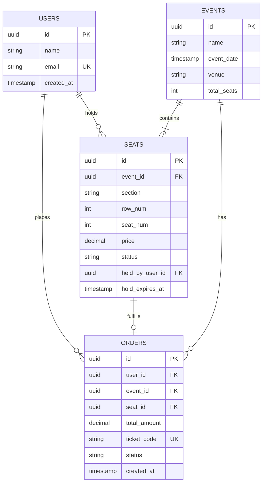

# 🎟️ System Design Document: TicketHub

A distributed, high-scale system design specification for **TicketHub**, an event ticketing platform built to handle massive traffic spikes during high-demand concert sales while strictly preventing seat double-booking.

---

## 1. Requirements

### Functional Requirements

- **Event Discovery:** Users can browse upcoming concerts, festivals, and events with filters (date, venue, genre).
- **Seat Map & Availability:** Users can view real-time seating charts and availability statuses for a selected event.
- **Temporary Seat Hold:** Users can temporarily hold a specific seat for 10 minutes while they enter payment information.
- **Ticket Purchase:** Users can complete secure payment for held seats to finalize the transaction.
- **Ticket Management:** Users can view and access their order history and digital tickets with unique verification codes.

### Non-Functional Requirements

- **Correctness & Consistency (Zero Double-Booking):** Strict transactional ACID guarantees. Two users must **never** be able to reserve or purchase the same seat under any circumstance.
- **Speed & Latency:** Browsing event catalogs and viewing seat maps must load in **under 200 ms** ($P99$).
- **Fairness:** High-demand ticket drops must enforce a strict First-Come, First-Served (FCFS) queuing mechanism with fair rate limits to deter automated scalping bots.
- **High Availability & Fault Tolerance:** The core system must maintain **99.99% availability** with no single point of failure (SPOF), gracefully absorbing extreme traffic spikes without crashing.

---

## 2. Capacity & Traffic Estimates

The platform must serve baseline everyday traffic as well as sudden, massive demand surges when stadium concerts go on sale. _(Standard engineering approximation: $1\text{ day} \approx 100,000\text{ seconds}$)_.

### Baseline System Facts

- **Registered User Base:** $2,000,000\text{ registered users}$.
- **Normal Daily Visitors:** $50,000\text{ unique visitors/day}$, each viewing an average of $10\text{ pages}$.
- **Normal Daily Sales:** $5,000\text{ tickets sold/day}$.
- **"Big Sale" Peak Scenario:** $200,000\text{ concurrent users}$ competing for $20,000\text{ seats}$ within the first $10\text{ minutes}$ ($600\text{ seconds}$).

---

### A. Normal Daily Traffic (Baseline)

- **Daily Page Views (Reads):**
  $$\text{Total Reads} = 50,000\text{ visitors} \times 10\text{ page views} = \mathbf{500,000\text{ reads/day}}$$
- **Average Read QPS:**
  $$\text{Average Read QPS} = \frac{500,000\text{ reads}}{100,000\text{ seconds}} = \mathbf{5\text{ reads/second}}$$
- **Normal Ticket Sales (Writes):**
  $$\text{Average Write QPS} = \frac{5,000\text{ tickets}}{100,000\text{ seconds}} = \mathbf{0.05\text{ writes/second}}$$
- _Baseline Takeaway:_ Everyday operations generate negligible load ($5\text{ reads/s}$, $0.05\text{ writes/s}$), which can comfortably run on a single low-spec application server and database instance.

---

### B. "Big Sale" Peak Traffic (The Bottleneck)

When a stadium concert goes on sale, traffic spikes instantaneously:

- **Peak Window:** $10\text{ minutes} = 600\text{ seconds}$.
- **Peak Read Volume:** $200,000\text{ users}$ actively refreshing the seat map $10\text{ times}$ during the rush:
  $$\text{Peak Reads} = 200,000 \times 10 = 2,000,000\text{ reads in 600 seconds}$$
  $$\text{Peak Read QPS} = \frac{2,000,000\text{ reads}}{600\text{ seconds}} \approx \mathbf{3,333\text{ reads/second}}$$
- **Peak Write / Hold Contention:** $200,000\text{ users}$ attempting to hold $20,000\text{ available seats}$:
  $$\text{Peak Write QPS} = \frac{200,000\text{ hold attempts}}{600\text{ seconds}} \approx \mathbf{333\text{ write attempts/second}}$$

---

### C. Traffic Comparison & Bottleneck Analysis

| Metric               | Normal Day                   | "Big Sale" Peak                           | Surge Factor                                    |
| :------------------- | :--------------------------- | :---------------------------------------- | :---------------------------------------------- |
| **Read Throughput**  | $5\text{ QPS}$               | $\mathbf{3,333\text{ QPS}}$               | **$666\times\text{ increase } (+66,560\%)$**    |
| **Write Throughput** | $0.05\text{ QPS}$            | $\mathbf{333\text{ QPS}}$                 | **$6,660\times\text{ increase } (+665,900\%)$** |
| **Contention Ratio** | $1 : 1\text{ (ample seats)}$ | $\mathbf{10 : 1}\text{ (users to seats)}$ | Extreme lock contention on row updates          |

_Critical Bottleneck:_ If $3,333\text{ reads/s}$ and $333\text{ concurrent write transactions}$ hit a single PostgreSQL instance directly, database connection pools will be exhausted within seconds, disk I/O will saturate, and the service will experience an outright outage. **Solution:** Protect the database using in-memory caching (Redis) for reads and a virtual waiting room queue (RabbitMQ / Redis) to meter write contention.

---

## 3. API Design

TicketHub uses a RESTful JSON API separating seat browsing, reservation holding, payment execution, and order retrieval.

### Endpoint 1: `GET /api/events`

- **Description:** Retrieves a paginated list of upcoming events.
- **Query Parameters:** `page=1&limit=20&genre=rock`
- **Response:** `200 OK`

```json
[
  {
    "id": "e4b2d56a-1122-48a1-871f-0e4f16bc4001",
    "name": "Coldplay: Music of the Spheres Tour",
    "venue": "Wembley Stadium",
    "date": "2026-11-15T19:30:00Z",
    "totalSeats": 20000,
    "availableSeats": 18450
  }
]
```

---

### Endpoint 2: `GET /api/events/{id}/seats`

- **Description:** Returns the complete seating layout and real-time seat availability for an event.
- **Response:** `200 OK` (Served primarily from Redis cache)

```json
{
  "eventId": "e4b2d56a-1122-48a1-871f-0e4f16bc4001",
  "updatedAt": "2026-10-12T02:00:00Z",
  "seats": [
    {
      "id": "s001-a12",
      "section": "A",
      "row": "1",
      "seatNumber": 12,
      "price": 120.0,
      "status": "available"
    },
    {
      "id": "s001-a13",
      "section": "A",
      "row": "1",
      "seatNumber": 13,
      "price": 120.0,
      "status": "held"
    }
  ]
}
```

---

### Endpoint 3: `POST /api/seats/{id}/hold`

- **Description:** Atomically places a 10-minute temporary lock on a specific seat for the authenticated user.
- **Headers:** `Authorization: Bearer <jwt_token>`
- **Success Response:** `201 Created`

```json
{
  "seatId": "s001-a12",
  "status": "held",
  "heldByUserId": "u991-8821-ab",
  "holdExpiresAt": "2026-10-12T02:10:00Z",
  "message": "Seat held successfully. Complete payment within 10 minutes."
}
```

- **Conflict Response:** `409 Conflict`

```json
{
  "error": "Seat is already held or sold by another customer."
}
```

---

### Endpoint 4: `POST /api/orders`

- **Description:** Finalizes the purchase of the currently held seat and processes payment.
- **Headers:** `Authorization: Bearer <jwt_token>`
- **Request Body:**

```json
{
  "seatId": "s001-a12",
  "eventId": "e4b2d56a-1122-48a1-871f-0e4f16bc4001",
  "paymentToken": "tok_visa_4242",
  "amount": 120.0
}
```

- **Success Response:** `201 Created`

```json
{
  "orderId": "ord_91827364",
  "seatId": "s001-a12",
  "status": "confirmed",
  "ticketCode": "TKT-CP-981240",
  "createdAt": "2026-10-12T02:05:32Z"
}
```

- **Expired Hold Response:** `410 Gone` (if user paid after the 10-minute window).

---

### Endpoint 5: `GET /api/users/{id}/tickets`

- **Description:** Retrieves all confirmed tickets purchased by the user.
- **Headers:** `Authorization: Bearer <jwt_token>`
- **Response:** `200 OK`

```json
[
  {
    "orderId": "ord_91827364",
    "ticketCode": "TKT-CP-981240",
    "eventName": "Coldplay: Music of the Spheres Tour",
    "venue": "Wembley Stadium",
    "seat": "Section A, Row 1, Seat 12",
    "eventDate": "2026-11-15T19:30:00Z"
  }
]
```

---

## 4. Data Model

A relational PostgreSQL database enforces referential integrity, strong typing, and transactional constraints.



### Relational Schema DDL & Integrity Constraints

```sql
-- 1. Users Table
CREATE TABLE users (
    id UUID PRIMARY KEY DEFAULT gen_random_uuid(),
    name VARCHAR(100) NOT NULL,
    email VARCHAR(255) UNIQUE NOT NULL,
    created_at TIMESTAMP WITH TIME ZONE DEFAULT CURRENT_TIMESTAMP
);

-- 2. Events Table
CREATE TABLE events (
    id UUID PRIMARY KEY DEFAULT gen_random_uuid(),
    name VARCHAR(255) NOT NULL,
    event_date TIMESTAMP WITH TIME ZONE NOT NULL,
    venue VARCHAR(255) NOT NULL,
    total_seats INT NOT NULL CHECK (total_seats > 0),
    created_at TIMESTAMP WITH TIME ZONE DEFAULT CURRENT_TIMESTAMP
);

-- 3. Seats Table
CREATE TABLE seats (
    id UUID PRIMARY KEY DEFAULT gen_random_uuid(),
    event_id UUID NOT NULL REFERENCES events(id) ON DELETE CASCADE,
    section VARCHAR(20) NOT NULL,
    row_num INT NOT NULL CHECK (row_num > 0),
    seat_num INT NOT NULL CHECK (seat_num > 0),
    price DECIMAL(10, 2) NOT NULL CHECK (price >= 0),
    status VARCHAR(20) NOT NULL DEFAULT 'available'
        CHECK (status IN ('available', 'held', 'sold')),
    held_by_user_id UUID REFERENCES users(id) ON DELETE SET NULL,
    hold_expires_at TIMESTAMP WITH TIME ZONE,

    -- Constraint 1: Physical uniqueness - prevent duplicate seats per event
    CONSTRAINT uq_event_seat UNIQUE (event_id, section, row_num, seat_num),

    -- Constraint 2: Seat state integrity - guarantees database-enforced correctness
    -- A seat cannot be 'held' without an assigned user and future expiration timestamp.
    -- An 'available' seat cannot retain a stale hold ownership or timestamp.
    CONSTRAINT chk_seat_hold_integrity CHECK (
        (status = 'available' AND held_by_user_id IS NULL AND hold_expires_at IS NULL) OR
        (status = 'held'      AND held_by_user_id IS NOT NULL AND hold_expires_at IS NOT NULL) OR
        (status = 'sold'      AND held_by_user_id IS NOT NULL)
    )
);

-- 4. Orders Table
CREATE TABLE orders (
    id UUID PRIMARY KEY DEFAULT gen_random_uuid(),
    user_id UUID NOT NULL REFERENCES users(id) ON DELETE RESTRICT,
    event_id UUID NOT NULL REFERENCES events(id) ON DELETE RESTRICT,
    seat_id UUID UNIQUE NOT NULL REFERENCES seats(id) ON DELETE RESTRICT,
    total_amount DECIMAL(10, 2) NOT NULL CHECK (total_amount >= 0),
    ticket_code VARCHAR(50) UNIQUE NOT NULL,
    status VARCHAR(20) NOT NULL DEFAULT 'confirmed'
        CHECK (status IN ('confirmed', 'refunded', 'cancelled')),
    created_at TIMESTAMP WITH TIME ZONE DEFAULT CURRENT_TIMESTAMP
);

-- Strategic Indexes for High-Speed Lookups & Expiration Sweeping
CREATE INDEX idx_seats_event_status ON seats(event_id, status);
CREATE INDEX idx_seats_hold_expiry ON seats(hold_expires_at) WHERE status = 'held';
CREATE INDEX idx_orders_user ON orders(user_id);
```

#### Database Schema Constraints Breakdown:

- **`uq_event_seat`:** Hard composite unique index `(event_id, section, row_num, seat_num)` ensuring that duplicate physical seats can never be inserted or represented twice.
- **`chk_seat_hold_integrity`:** Multi-column CHECK constraint preventing corrupted seat states. If a hold expires or is cancelled, the system is physically forced by the database engine to nullify `held_by_user_id` and `hold_expires_at` when marking the seat `available`.
- **`orders.seat_id UNIQUE`:** Hardware/storage-level guarantee preventing double-selling. Even if application-level validation completely failed, the database engine will reject a second `INSERT` for the same `seat_id` with a unique constraint violation (`23505 unique_violation`).
- **Foreign Key Delete Policies:** `ON DELETE RESTRICT` on `orders` prevents accidental deletion of user accounts or events from deleting financial audit records.

---

## 5. Preventing Double-Booking: Concurrency Control & Locking Mechanics

Preventing two concurrent users from reserving or purchasing the same seat is the fundamental correctness requirement of TicketHub. In high-demand sales (where 10+ users contend for the same seat within milliseconds), fairness and correctness require strict concurrency control, explicit transaction boundaries, and a clearly chosen locking strategy.

---

### A. Transaction Isolation Level Analysis

TicketHub configures PostgreSQL to use **`READ COMMITTED` with explicit row-level locking** (rather than `REPEATABLE READ` or `SERIALIZABLE`).

#### Why `SERIALIZABLE` and `REPEATABLE READ` Fail Under Sudden Surges:

1. Under `SERIALIZABLE` or `REPEATABLE READ`, if Transaction A and Transaction B attempt to update the same seat row concurrently, the first transaction commits while the second is aborted by the database engine with:
   $$\text{ERROR: 40001: could not serialize access due to concurrent update}$$
2. Under our peak scenario ($200,000\text{ users}$ contending for $20,000\text{ seats}$), 90% of transactions hitting the same seat would throw serialization abort errors, triggering massive application retry storms, saturating connection pools, and knocking down the database.

#### Why `READ COMMITTED` with Row-Level Locking Is Optimal:

1. In PostgreSQL's `READ COMMITTED` isolation level, when Transaction B attempts an `UPDATE` on a row locked by Transaction A, Transaction B simply waits for Transaction A to complete.
2. Crucially, once Transaction A commits, Transaction B **re-evaluates the query's `WHERE` clause** against the newly committed version of the row.
3. Because Transaction A changed `status` to `'held'`, Transaction B's `WHERE status = 'available'` predicate evaluates to `FALSE`. The query updates `0` rows and completes immediately without throwing a serialization abort error.
4. The application reads `rows_affected == 0`, rolls back cleanly, and returns an instant `409 Conflict`.

---

### B. Mechanics of Locking: Two Approaches Compared

When implementing seat holds, system designers have two distinct locking choices: **Database Pessimistic Row Locking** vs. **Distributed Tokens with TTL in Redis**. TicketHub deploys a **Two-Tier Hybrid Architecture** that leverages the strengths of both.

```text
                  Incoming Hold Requests (Peak: 333 writes/s, high hotspot contention)
                                                │
                                                ▼
     ┌─────────────────────────────────────────────────────────────────────────────────────┐
     │ TIER 1: Distributed Token with TTL (Redis In-Memory Guard)                          │
     │ • Atomic Lua script evaluates lock in <1 ms                                         │
     │ • Only 1 user acquires the key 'seat:lock:{seat_id}' with EX 600                    │
     │ • 99% of losing contenders fail immediately at Redis without touching PostgreSQL     │
     └──────────────────────────────────┬──────────────────────────────────────────────────┘
                                        │ (Winner only)
                                        ▼
     ┌─────────────────────────────────────────────────────────────────────────────────────┐
     │ TIER 2: Relational ACID Transaction (PostgreSQL Authoritative Source of Truth)       │
     │ • Isolation Level: READ COMMITTED with Row-Level Lock & Statement Timeout           │
     │ • Enforces foreign keys, CHECK constraints, and financial transaction boundaries   │
     │ • Persists status = 'held', held_by_user_id, hold_expires_at                        │
     └─────────────────────────────────────────────────────────────────────────────────────┘
```

#### Comparison Matrix:

| Dimension               | Option 1: Database Pessimistic Row Locking                                    | Option 2: Distributed Tokens with TTL (Redis)                          | TicketHub's Hybrid Choice                           |
| :---------------------- | :---------------------------------------------------------------------------- | :--------------------------------------------------------------------- | :-------------------------------------------------- |
| **Mechanics**           | `SELECT ... FOR UPDATE` or conditional `UPDATE` row lock in PostgreSQL engine | Atomic key acquisition `SET key val NX EX 600` via Lua script in Redis | **Tier 1 (Redis) + Tier 2 (Postgres)**              |
| **Throughput**          | Limited by disk I/O and connection pools ($\approx 1,000\text{ write tx/s}$)  | In-memory single-threaded execution ($>100,000\text{ ops/s}$)          | Extreme speed at edge; low write load at DB         |
| **Contention Handling** | Contenders queue in database lock manager; can exhaust pool under surge       | Non-blocking or sub-millisecond check; immediate 409 rejection         | Rejects losers in $<2\text{ ms}$; shields DB        |
| **TTL Expiration**      | Requires active polling sweeper or lazy evaluation                            | Native Redis expiration (`EX 600`) frees memory automatically          | Native Redis TTL + DB lazy evaluation + sweeper     |
| **Consistency**         | 100% ACID compliant, relational integrity guaranteed                          | In-memory; network partition could cause stale state                   | Redis gates traffic; Postgres guarantees ACID truth |

---

### C. Step 1: Executing the Seat Hold (Transaction Boundaries & Mechanics)

#### 1. Fast-Path Lock Acquisition in Redis (Tier 1):

Before touching the database, the application executes an atomic Lua script in Redis:

```lua
-- Redis Atomic Seat Hold Token Acquisition (Lua Script)
-- KEYS[1] = "seat:lock:" .. seatId
-- ARGV[1] = userId
-- ARGV[2] = 600 (10 minutes TTL in seconds)

if redis.call("EXISTS", KEYS[1]) == 0 then
    redis.call("SET", KEYS[1], ARGV[1], "EX", ARGV[2])
    return 1 -- Token successfully acquired
else
    return 0 -- Seat already held or locked by another user
end
```

If the script returns `0`, the API immediately returns `409 Conflict ("Seat is currently held by another user")`. PostgreSQL is never queried.

#### 2. Database Authoritative Hold Transaction (Tier 2):

If the Redis lock succeeds, the winner's request opens an explicit database transaction with statement timeout boundaries:

```sql
-- Explicit Transaction Boundary Definition
BEGIN TRANSACTION ISOLATION LEVEL READ COMMITTED;

-- Prevent runaway connection pool stalls if lock contention spikes
SET LOCAL statement_timeout = '2000ms';

-- Atomic conditional seat hold with lazy expiration evaluation
UPDATE seats
SET status = 'held',
    held_by_user_id = 'UserA_UUID',
    hold_expires_at = NOW() + INTERVAL '10 minutes'
WHERE id = 'Seat_1_UUID'
  AND (
      status = 'available'
      OR (status = 'held' AND hold_expires_at < NOW()) -- Inline lazy expiration
  );

-- Application Verification:
-- IF rows_affected == 1:
COMMIT;
-- Return HTTP 201 Created

-- IF rows_affected == 0:
-- (Seat was sold or held concurrently)
ROLLBACK;
-- Release Redis key: DEL seat:lock:Seat_1_UUID
-- Return HTTP 409 Conflict
```

---

### D. Step 2: Finalizing Payment & Transitioning to 'sold'

When User A submits payment within the 10-minute hold window, the payment gateway token is charged. Upon payment authorization, the system finalizes the sale within an ACID transaction:

```sql
BEGIN TRANSACTION ISOLATION LEVEL READ COMMITTED;
SET LOCAL statement_timeout = '3000ms';

-- Step 1: Transition seat from 'held' to 'sold'
-- Strictly verify the hold belongs to User A and has NOT expired
UPDATE seats
SET status = 'sold',
    hold_expires_at = NULL
WHERE id = 'Seat_1_UUID'
  AND held_by_user_id = 'UserA_UUID'
  AND status = 'held'
  AND hold_expires_at >= NOW();

-- Step 2: Verify exactly 1 row was updated
-- If rows_affected == 0, user paid after the 10-minute window expired!
-- Action: ROLLBACK transaction, issue refund via payment gateway, return HTTP 410 Gone.

-- Step 3: Insert permanent audit and fulfillment record into orders table
INSERT INTO orders (
    user_id,
    event_id,
    seat_id,
    total_amount,
    ticket_code,
    status
) VALUES (
    'UserA_UUID',
    'Event_UUID',
    'Seat_1_UUID',
    120.00,
    'TKT-CP-981240',
    'confirmed'
);

COMMIT;

-- Post-Commit: Remove the Redis hold token now that the seat is permanently sold
-- DEL seat:lock:Seat_1_UUID
```

#### Dual Protection Against Double-Booking:

1. **Row-Level Conditional Transition:** The seat update only succeeds if `held_by_user_id = 'UserA_UUID'`, `status = 'held'`, and `hold_expires_at >= NOW()`.
2. **Database Unique Constraint (`orders.seat_id UNIQUE`):** The relational engine physically forbids creating two orders for the same seat. Even under extreme edge conditions, the database will raise constraint violation error `23505`, preventing duplicate tickets from being issued.

---

### E. Hold Expiration & Seat Reclamation Strategy

To guarantee fairness and prevent seats from becoming permanently locked if a user abandons their browser, TicketHub implements a **Two-Tier Expiration Model**:

1. **Passive / Lazy Expiration:** Handled directly in the SQL conditional queries:
   $$\text{status} = \text{'held'} \text{ AND } \text{hold\_expires\_at} < \text{NOW}()$$
   If an abandoned seat is clicked by a new user after 10 minutes, the query automatically reclaims the seat and assigns it to the new user in a single atomic operation without waiting for a background worker.
2. **Active Asynchronous Sweeper (Scheduled Worker):**
   - A lightweight background worker runs every 15 seconds to sweep abandoned seats:

```sql
UPDATE seats
SET status = 'available',
    held_by_user_id = NULL,
    hold_expires_at = NULL
WHERE status = 'held'
  AND hold_expires_at < NOW();
```

   - Thanks to the partial index `CREATE INDEX idx_seats_hold_expiry ON seats(hold_expires_at) WHERE status = 'held'`, this query executes in $<5\text{ ms}$, freeing abandoned seats and broadcasting an update via WebSocket/Redis PubSub to refresh the live seat map for waiting fans.

---

## 6. High-Level Architecture & Surviving the Big Sale

```text
                               [200,000 Users]
                                      │
                                      ▼
                      ┌───────────────────────────────┐
                      │   Cloudflare CDN & WAF Edge   │ (DDoS protection, static assets, bot shield)
                      └───────────────┬───────────────┘
                                      │
                                      ▼
                      ┌───────────────────────────────┐
                      │  Load Balancer (Nginx / ALB)  │ (Round-Robin SSL termination & health checks)
                      └───────────────┬───────────────┘
                                      │
          ┌───────────────────────────┴───────────────────────────┐
          ▼                                                       ▼
  [App Server Fleet 1..N]                                 [Virtual Waiting Room]
  (Stateless Node.js Instances)                           (Redis Sorted Sets / Token Bucket)
          │                                                       │
          ├──────────────────────────┬────────────────────────────┤
          ▼                          ▼                            ▼
  ┌────────────────┐        ┌──────────────────┐        ┌───────────────────┐
  │  Redis Cache   │        │   RabbitMQ Bus   │        │ Primary PostgreSQL│ (Writes & Holds)
  │ (Seat Maps)    │        │ (Async Invoices) │        └─────────┬─────────┘
  └────────────────┘        └──────────────────┘                  │ (WAL Replication)
                                                                  ▼
                                                        ┌───────────────────┐
                                                        │   Read Replicas   │ (Browse & History)
                                                        └───────────────────┘
```

### Component Breakdown & How It Survives the Rush:

1. **Cloudflare CDN & WAF Edge:**
   - Absorbs DDoS attacks, filters automated scrapers, and caches static assets (`HTML`, `CSS`, `JS`, venue maps) with a $95\%+$ edge hit ratio.
2. **Nginx Load Balancer:**
   - Evenly distributes incoming HTTPS requests across a stateless pool of application instances using Least Connections or Round-Robin.
3. **Stateless Application Servers (Horizontally Scaled):**
   - Auto-scale from 5 instances to 50+ instances using container orchestration (Kubernetes/ECS) in response to CPU and request volume triggers. Because instances store zero session state, any instance can handle any user.
4. **Virtual Waiting Room (Queue Throttling via Redis):**
   - During the $200,000\text{-user}$ surge, users entering the ticket sale receive a cryptographically signed queue token stored in a Redis Sorted Set (`ZADD waiting_room timestamp userId`).
   - A queue controller admits only $500\text{ users/minute}$ into the active checkout flow. The remaining users see a live animated countdown. This gates traffic so write attempts to PostgreSQL never exceed $50\text{--}100\text{ QPS}$, completely shielding the database from concurrency crashes.
5. **Redis Cache-Aside (Seat Maps):**
   - The $3,333\text{ reads/sec}$ for seat map data are served entirely from Redis in $<1\text{ ms}$. When a seat is held or sold, the application updates the cached seat map key (`seats:event:1`) or lets it expire under a 3-second TTL.
6. **Primary PostgreSQL Database (Row-Level Locked Writes):**
   - Dedicated strictly to executing ACID hold transactions and payment confirmations.
7. **Read Replica PostgreSQL Cluster:**
   - Asynchronously streams data from the primary to fulfill read-only queries (e.g. browsing the event catalog, viewing purchase history) without consuming primary CPU cycles.

---

## 7. Architectural Trade-offs

### Trade-off 1: Cache Eventual Consistency vs. Database Survival

- **Decision:** Serve the seat map (`GET /api/events/{id}/seats`) from a Redis cache with a short TTL (2–3 seconds) instead of querying PostgreSQL on every refresh.
- **Benefit:** Reduces database query load from $3,333\text{ QPS}$ down to $<1\text{ QPS}$, preventing total database crash.
- **Trade-off (The Cost):** Eventual consistency. For up to 3 seconds, a seat that was just held by User A may still appear as `"available"` on User B's screen. If User B clicks it, they receive a `409 Conflict` error.
- **Justification:** Accepting occasional 409 errors on hot seats is an essential trade-off to ensure the entire site stays online and operational for all 200,000 users.

---

### Trade-off 2: Virtual Waiting Room vs. Immediate Instant Access

- **Decision:** Place users in a FIFO virtual waiting room during the ticket release rather than allowing all 200,000 users to hammer the checkout endpoints simultaneously.
- **Benefit:** Enforces fairness (first-come, first-served), guarantees 99.99% system uptime, and prevents database connection pool exhaustion.
- **Trade-off (The Cost):** User friction. Customers must wait in an online queue for several minutes instead of purchasing instantly.
- **Justification:** A controlled queue that guarantees successful, double-booking-free transactions is vastly superior to an unconstrained system crash where no users can purchase tickets.

---

### Trade-off 3: Two-Tier Hybrid Locking (Redis TTL + DB Row Lock) vs. Single-Tier Pure DB Locking

- **Decision:** Implement a two-tier locking model where incoming seat hold attempts must first acquire an in-memory distributed token with a 600-second TTL in Redis via an atomic Lua script before touching PostgreSQL, rather than relying exclusively on PostgreSQL pessimistic row locks.
- **Benefit:** During peak surges ($200,000\text{ users}$ contending for $20,000\text{ seats}$), hotspot seats (e.g., front-row seats) receive hundreds of concurrent requests in the same millisecond. Redis intercepts and deflects $99\%$ of losing attempts in $<1\text{ ms}$ in-memory. Only the single winning request reaches PostgreSQL, reducing database write connection contention from $333+\text{ concurrent transactions}$ to low tens.
- **Trade-off (The Cost):** System complexity and distributed state management. If Redis crashes or experiences network partitioning, Redis keys could become desynchronized from PostgreSQL until TTL expiry.
- **Justification:** Without the Redis Tier 1 guard, hundreds of concurrent database transactions queuing on the same row lock would exhaust PostgreSQL's connection pool (`max_connections`) and saturate disk I/O, crashing the database for all users.

---

### Trade-off 4: Pessimistic Row Locking vs. Optimistic Concurrency Control (OCC)

- **Decision:** Use pessimistic row-level locking via conditional SQL `UPDATE ... WHERE status = 'available'` rather than optimistic locking using version numbers (`version = 1`).
- **Benefit:** In ultra-high contention scenarios (thousands of users attempting to claim the same front-row seat), optimistic concurrency causes $99.9\%$ of transactions to fail with version conflicts and retry repeatedly, generating a thundering herd storm. Pessimistic row locking immediately serializes access at the database engine level, rejecting non-winners cleanly in one pass.
- **Trade-off (The Cost):** Minor thread blocking on that specific seat row while the update executes.
- **Justification:** Because seats are individual records, lock contention is isolated to identical seat IDs, leaving all other seat purchases unblocked.
