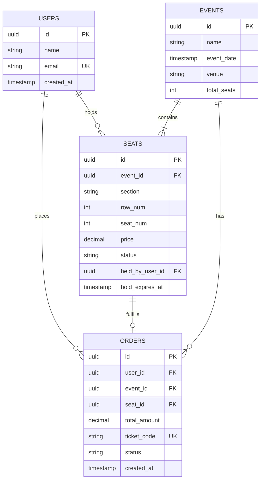

# 🎟️ System Design Document: TicketHub

A distributed, high-scale system design specification for **TicketHub**, an event ticketing platform built to handle massive traffic spikes during high-demand concert sales while strictly preventing seat double-booking.

---

## 1. Requirements

### Functional Requirements
- **Event Discovery:** Users can browse upcoming concerts, festivals, and events with filters (date, venue, genre).
- **Seat Map & Availability:** Users can view real-time seating charts and availability statuses for a selected event.
- **Temporary Seat Hold:** Users can temporarily hold a specific seat for 10 minutes while they enter payment information.
- **Ticket Purchase:** Users can complete secure payment for held seats to finalize the transaction.
- **Ticket Management:** Users can view and access their order history and digital tickets with unique verification codes.

### Non-Functional Requirements
- **Correctness & Consistency (Zero Double-Booking):** Strict transactional ACID guarantees. Two users must **never** be able to reserve or purchase the same seat under any circumstance.
- **Speed & Latency:** Browsing event catalogs and viewing seat maps must load in **under 200 ms** ($P99$).
- **Fairness:** High-demand ticket drops must enforce a strict First-Come, First-Served (FCFS) queuing mechanism with fair rate limits to deter automated scalping bots.
- **High Availability & Fault Tolerance:** The core system must maintain **99.99% availability** with no single point of failure (SPOF), gracefully absorbing extreme traffic spikes without crashing.

---

## 2. Capacity & Traffic Estimates

The platform must serve baseline everyday traffic as well as sudden, massive demand surges when stadium concerts go on sale. *(Standard engineering approximation: $1\text{ day} \approx 100,000\text{ seconds}$)*.

### Baseline System Facts
- **Registered User Base:** $2,000,000\text{ registered users}$.
- **Normal Daily Visitors:** $50,000\text{ unique visitors/day}$, each viewing an average of $10\text{ pages}$.
- **Normal Daily Sales:** $5,000\text{ tickets sold/day}$.
- **"Big Sale" Peak Scenario:** $200,000\text{ concurrent users}$ competing for $20,000\text{ seats}$ within the first $10\text{ minutes}$ ($600\text{ seconds}$).

---

### A. Normal Daily Traffic (Baseline)
- **Daily Page Views (Reads):**
  $$\text{Total Reads} = 50,000\text{ visitors} \times 10\text{ page views} = \mathbf{500,000\text{ reads/day}}$$
- **Average Read QPS:**
  $$\text{Average Read QPS} = \frac{500,000\text{ reads}}{100,000\text{ seconds}} = \mathbf{5\text{ reads/second}}$$
- **Normal Ticket Sales (Writes):**
  $$\text{Average Write QPS} = \frac{5,000\text{ tickets}}{100,000\text{ seconds}} = \mathbf{0.05\text{ writes/second}}$$
- *Baseline Takeaway:* Everyday operations generate negligible load ($5\text{ reads/s}$, $0.05\text{ writes/s}$), which can comfortably run on a single low-spec application server and database instance.

---

### B. "Big Sale" Peak Traffic (The Bottleneck)
When a stadium concert goes on sale, traffic spikes instantaneously:
- **Peak Window:** $10\text{ minutes} = 600\text{ seconds}$.
- **Peak Read Volume:** $200,000\text{ users}$ actively refreshing the seat map $10\text{ times}$ during the rush:
  $$\text{Peak Reads} = 200,000 \times 10 = 2,000,000\text{ reads in 600 seconds}$$
  $$\text{Peak Read QPS} = \frac{2,000,000\text{ reads}}{600\text{ seconds}} \approx \mathbf{3,333\text{ reads/second}}$$
- **Peak Write / Hold Contention:** $200,000\text{ users}$ attempting to hold $20,000\text{ available seats}$:
  $$\text{Peak Write QPS} = \frac{200,000\text{ hold attempts}}{600\text{ seconds}} \approx \mathbf{333\text{ write attempts/second}}$$

---

### C. Traffic Comparison & Bottleneck Analysis

| Metric | Normal Day | "Big Sale" Peak | Surge Factor |
| :--- | :--- | :--- | :--- |
| **Read Throughput** | $5\text{ QPS}$ | $\mathbf{3,333\text{ QPS}}$ | **$666\times\text{ increase } (+66,560\%)$** |
| **Write Throughput** | $0.05\text{ QPS}$ | $\mathbf{333\text{ QPS}}$ | **$6,660\times\text{ increase } (+665,900\%)$** |
| **Contention Ratio** | $1 : 1\text{ (ample seats)}$ | $\mathbf{10 : 1}\text{ (users to seats)}$ | Extreme lock contention on row updates |

*Critical Bottleneck:* If $3,333\text{ reads/s}$ and $333\text{ concurrent write transactions}$ hit a single PostgreSQL instance directly, database connection pools will be exhausted within seconds, disk I/O will saturate, and the service will experience an outright outage. **Solution:** Protect the database using in-memory caching (Redis) for reads and a virtual waiting room queue (RabbitMQ / Redis) to meter write contention.

---

## 3. API Design

TicketHub uses a RESTful JSON API separating seat browsing, reservation holding, payment execution, and order retrieval.

### Endpoint 1: `GET /api/events`
* **Description:** Retrieves a paginated list of upcoming events.
* **Query Parameters:** `page=1&limit=20&genre=rock`
* **Response:** `200 OK`
  ```json
  [
    {
      "id": "e4b2d56a-1122-48a1-871f-0e4f16bc4001",
      "name": "Coldplay: Music of the Spheres Tour",
      "venue": "Wembley Stadium",
      "date": "2026-11-15T19:30:00Z",
      "totalSeats": 20000,
      "availableSeats": 18450
    }
  ]
  ```

---

### Endpoint 2: `GET /api/events/{id}/seats`
* **Description:** Returns the complete seating layout and real-time seat availability for an event.
* **Response:** `200 OK` (Served primarily from Redis cache)
  ```json
  {
    "eventId": "e4b2d56a-1122-48a1-871f-0e4f16bc4001",
    "updatedAt": "2026-10-12T02:00:00Z",
    "seats": [
      {
        "id": "s001-a12",
        "section": "A",
        "row": "1",
        "seatNumber": 12,
        "price": 120.00,
        "status": "available"
      },
      {
        "id": "s001-a13",
        "section": "A",
        "row": "1",
        "seatNumber": 13,
        "price": 120.00,
        "status": "held"
      }
    ]
  }
  ```

---

### Endpoint 3: `POST /api/seats/{id}/hold`
* **Description:** Atomically places a 10-minute temporary lock on a specific seat for the authenticated user.
* **Headers:** `Authorization: Bearer <jwt_token>`
* **Success Response:** `201 Created`
  ```json
  {
    "seatId": "s001-a12",
    "status": "held",
    "heldByUserId": "u991-8821-ab",
    "holdExpiresAt": "2026-10-12T02:10:00Z",
    "message": "Seat held successfully. Complete payment within 10 minutes."
  }
  ```
* **Conflict Response:** `409 Conflict`
  ```json
  {
    "error": "Seat is already held or sold by another customer."
  }
  ```

---

### Endpoint 4: `POST /api/orders`
* **Description:** Finalizes the purchase of the currently held seat and processes payment.
* **Headers:** `Authorization: Bearer <jwt_token>`
* **Request Body:**
  ```json
  {
    "seatId": "s001-a12",
    "eventId": "e4b2d56a-1122-48a1-871f-0e4f16bc4001",
    "paymentToken": "tok_visa_4242",
    "amount": 120.00
  }
  ```
* **Success Response:** `201 Created`
  ```json
  {
    "orderId": "ord_91827364",
    "seatId": "s001-a12",
    "status": "confirmed",
    "ticketCode": "TKT-CP-981240",
    "createdAt": "2026-10-12T02:05:32Z"
  }
  ```
* **Expired Hold Response:** `410 Gone` (if user paid after the 10-minute window).

---

### Endpoint 5: `GET /api/users/{id}/tickets`
* **Description:** Retrieves all confirmed tickets purchased by the user.
* **Headers:** `Authorization: Bearer <jwt_token>`
* **Response:** `200 OK`
  ```json
  [
    {
      "orderId": "ord_91827364",
      "ticketCode": "TKT-CP-981240",
      "eventName": "Coldplay: Music of the Spheres Tour",
      "venue": "Wembley Stadium",
      "seat": "Section A, Row 1, Seat 12",
      "eventDate": "2026-11-15T19:30:00Z"
    }
  ]
  ```

---

## 4. Data Model

A relational PostgreSQL database enforces referential integrity, strong typing, and transactional constraints.



### Relational Schema DDL & Constraints

```sql
-- 1. Users Table
CREATE TABLE users (
    id UUID PRIMARY KEY DEFAULT gen_random_uuid(),
    name VARCHAR(100) NOT NULL,
    email VARCHAR(255) UNIQUE NOT NULL,
    created_at TIMESTAMP WITH TIME ZONE DEFAULT CURRENT_TIMESTAMP
);

-- 2. Events Table
CREATE TABLE events (
    id UUID PRIMARY KEY DEFAULT gen_random_uuid(),
    name VARCHAR(255) NOT NULL,
    event_date TIMESTAMP WITH TIME ZONE NOT NULL,
    venue VARCHAR(255) NOT NULL,
    total_seats INT NOT NULL,
    created_at TIMESTAMP WITH TIME ZONE DEFAULT CURRENT_TIMESTAMP
);

-- 3. Seats Table
CREATE TABLE seats (
    id UUID PRIMARY KEY DEFAULT gen_random_uuid(),
    event_id UUID NOT NULL REFERENCES events(id) ON DELETE CASCADE,
    section VARCHAR(20) NOT NULL,
    row_num INT NOT NULL,
    seat_num INT NOT NULL,
    price DECIMAL(10, 2) NOT NULL,
    status VARCHAR(20) NOT NULL DEFAULT 'available' 
        CHECK (status IN ('available', 'held', 'sold')),
    held_by_user_id UUID REFERENCES users(id) ON DELETE SET NULL,
    hold_expires_at TIMESTAMP WITH TIME ZONE,
    -- Prevent duplicate physical seats inside the same event
    CONSTRAINT uq_event_seat UNIQUE (event_id, section, row_num, seat_num)
);

-- 4. Orders Table
CREATE TABLE orders (
    id UUID PRIMARY KEY DEFAULT gen_random_uuid(),
    user_id UUID NOT NULL REFERENCES users(id) ON DELETE RESTRICT,
    event_id UUID NOT NULL REFERENCES events(id) ON DELETE RESTRICT,
    seat_id UUID UNIQUE NOT NULL REFERENCES seats(id) ON DELETE RESTRICT,
    total_amount DECIMAL(10, 2) NOT NULL,
    ticket_code VARCHAR(50) UNIQUE NOT NULL,
    status VARCHAR(20) NOT NULL DEFAULT 'confirmed'
        CHECK (status IN ('confirmed', 'refunded', 'cancelled')),
    created_at TIMESTAMP WITH TIME ZONE DEFAULT CURRENT_TIMESTAMP
);

-- Strategic Indexes for High-Speed Lookups
CREATE INDEX idx_seats_event_status ON seats(event_id, status);
CREATE INDEX idx_seats_hold_expiry ON seats(hold_expires_at) WHERE status = 'held';
CREATE INDEX idx_orders_user ON orders(user_id);
```

---

## 5. Preventing Double-Booking (Correctness & Consistency)

Preventing two concurrent users from claiming the same seat is the single most critical correctness requirement. TicketHub achieves this through **ACID database transactions**, **row-level locking**, and **atomic conditional updates**.

### Step 1: Atomic Seat Hold with Row-Level Locking
When User A and User B both click "Hold Seat #1" at the exact same millisecond:

```sql
BEGIN TRANSACTION;

-- Attempt an atomic conditional update
UPDATE seats
SET status = 'held',
    held_by_user_id = 'UserA_UUID',
    hold_expires_at = NOW() + INTERVAL '10 minutes'
WHERE id = 'Seat_1_UUID'
  AND (
      status = 'available' 
      OR (status = 'held' AND hold_expires_at < NOW()) -- Lazy expiry release
  );

COMMIT;
```

#### How the Database Guarantees Correctness:
1. **Row-Level Write Lock:** PostgreSQL automatically places an exclusive row-level lock on `Seat_1_UUID` when evaluating the `UPDATE` query.
2. **First Transaction Wins:** If User A's transaction arrives 1 microsecond earlier, it acquires the lock. The condition `WHERE status = 'available'` evaluates to `TRUE`. The row is updated to `'held'`, and the query reports `Rows Affected = 1`. The server returns `201 Created`.
3. **Second Transaction Fails Safely:** User B's transaction waits for User A's lock to release. Once released, User B evaluates the row. Because the status is now `'held'` and `hold_expires_at` is in the future, the condition evaluates to `FALSE`. The query reports `Rows Affected = 0`.
4. **No Double-Booking:** The application inspects the row count. Seeing `0`, it rolls back User B's transaction and immediately returns `409 Conflict` (*"Seat is already reserved"*).

---

### Step 2: Finalizing Payment & Transitioning to 'sold'
When User A completes payment, the application executes the final purchase transaction:

```sql
BEGIN TRANSACTION;

-- Confirm the hold belongs to User A and has not expired
UPDATE seats
SET status = 'sold',
    hold_expires_at = NULL
WHERE id = 'Seat_1_UUID'
  AND held_by_user_id = 'UserA_UUID'
  AND status = 'held'
  AND hold_expires_at >= NOW();

-- If 1 row updated, record the final order
INSERT INTO orders (user_id, event_id, seat_id, total_amount, ticket_code)
VALUES ('UserA_UUID', 'Event_UUID', 'Seat_1_UUID', 120.00, 'TKT-991204');

COMMIT;
```

*Unique Constraint Safeguard:* The `orders` table enforces a `UNIQUE(seat_id)` constraint. Even if an unforeseen bug occurred at the application layer, the database engine physically rejects inserting a second order for the same seat ID.

---

## 6. High-Level Architecture & Surviving the Big Sale

```text
                               [200,000 Users]
                                      │
                                      ▼
                      ┌───────────────────────────────┐
                      │   Cloudflare CDN & WAF Edge   │ (DDoS protection, static assets, bot shield)
                      └───────────────┬───────────────┘
                                      │
                                      ▼
                      ┌───────────────────────────────┐
                      │  Load Balancer (Nginx / ALB)  │ (Round-Robin SSL termination & health checks)
                      └───────────────┬───────────────┘
                                      │
          ┌───────────────────────────┴───────────────────────────┐
          ▼                                                       ▼
  [App Server Fleet 1..N]                                 [Virtual Waiting Room]
  (Stateless Node.js Instances)                           (Redis Sorted Sets / Token Bucket)
          │                                                       │
          ├──────────────────────────┬────────────────────────────┤
          ▼                          ▼                            ▼
  ┌────────────────┐        ┌──────────────────┐        ┌───────────────────┐
  │  Redis Cache   │        │   RabbitMQ Bus   │        │ Primary PostgreSQL│ (Writes & Holds)
  │ (Seat Maps)    │        │ (Async Invoices) │        └─────────┬─────────┘
  └────────────────┘        └──────────────────┘                  │ (WAL Replication)
                                                                  ▼
                                                        ┌───────────────────┐
                                                        │   Read Replicas   │ (Browse & History)
                                                        └───────────────────┘
```

### Component Breakdown & How It Survives the Rush:

1. **Cloudflare CDN & WAF Edge:**
   * Absorbs DDoS attacks, filters automated scrapers, and caches static assets (`HTML`, `CSS`, `JS`, venue maps) with a $95\%+$ edge hit ratio.
2. **Nginx Load Balancer:**
   * Evenly distributes incoming HTTPS requests across a stateless pool of application instances using Least Connections or Round-Robin.
3. **Stateless Application Servers (Horizontally Scaled):**
   * Auto-scale from 5 instances to 50+ instances using container orchestration (Kubernetes/ECS) in response to CPU and request volume triggers. Because instances store zero session state, any instance can handle any user.
4. **Virtual Waiting Room (Queue Throttling via Redis):**
   * During the $200,000\text{-user}$ surge, users entering the ticket sale receive a cryptographically signed queue token stored in a Redis Sorted Set (`ZADD waiting_room timestamp userId`).
   * A queue controller admits only $500\text{ users/minute}$ into the active checkout flow. The remaining users see a live animated countdown. This gates traffic so write attempts to PostgreSQL never exceed $50\text{--}100\text{ QPS}$, completely shielding the database from concurrency crashes.
5. **Redis Cache-Aside (Seat Maps):**
   * The $3,333\text{ reads/sec}$ for seat map data are served entirely from Redis in $<1\text{ ms}$. When a seat is held or sold, the application updates the cached seat map key (`seats:event:1`) or lets it expire under a 3-second TTL.
6. **Primary PostgreSQL Database (Row-Level Locked Writes):**
   * Dedicated strictly to executing ACID hold transactions and payment confirmations.
7. **Read Replica PostgreSQL Cluster:**
   * Asynchronously streams data from the primary to fulfill read-only queries (e.g. browsing the event catalog, viewing purchase history) without consuming primary CPU cycles.

---

## 7. Architectural Trade-offs

### Trade-off 1: Cache Eventual Consistency vs. Database Survival
* **Decision:** Serve the seat map (`GET /api/events/{id}/seats`) from a Redis cache with a short TTL (2–3 seconds) instead of querying PostgreSQL on every refresh.
* **Benefit:** Reduces database query load from $3,333\text{ QPS}$ down to $<1\text{ QPS}$, preventing total database crash.
* **Trade-off (The Cost):** Eventual consistency. For up to 3 seconds, a seat that was just held by User A may still appear as `"available"` on User B's screen. If User B clicks it, they receive a `409 Conflict` error.
* **Justification:** Accepting occasional 409 errors on hot seats is an essential trade-off to ensure the entire site stays online and operational for all 200,000 users.

---

### Trade-off 2: Virtual Waiting Room vs. Immediate Instant Access
* **Decision:** Place users in a FIFO virtual waiting room during the ticket release rather than allowing all 200,000 users to hammer the checkout endpoints simultaneously.
* **Benefit:** Enforces fairness (first-come, first-served), guarantees 99.99% system uptime, and prevents database connection pool exhaustion.
* **Trade-off (The Cost):** User friction. Customers must wait in an online queue for several minutes instead of purchasing instantly.
* **Justification:** A controlled queue that guarantees successful, double-booking-free transactions is vastly superior to an unconstrained system crash where no users can purchase tickets.

---

### Trade-off 3: Pessimistic Row Locking vs. Optimistic Concurrency Control (OCC)
* **Decision:** Use pessimistic row-level locking via conditional SQL `UPDATE ... WHERE status = 'available'` rather than optimistic locking using version numbers (`version = 1`).
* **Benefit:** In ultra-high contention scenarios (thousands of users attempting to claim the same front-row seat), optimistic concurrency causes $99.9\%$ of transactions to fail with version conflicts and retry repeatedly, generating a thundering herd storm. Pessimistic row locking immediately serializes access at the database engine level, rejecting non-winners cleanly in one pass.
* **Trade-off (The Cost):** Minor thread blocking on that specific seat row while the update executes.
* **Justification:** Because seats are individual records, lock contention is isolated to identical seat IDs, leaving all other seat purchases unblocked.
